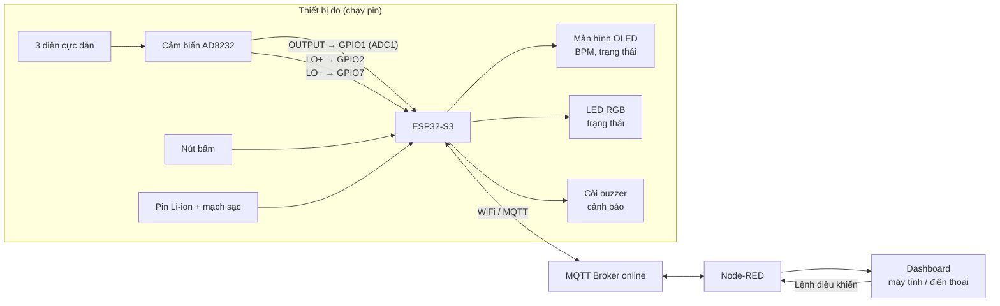
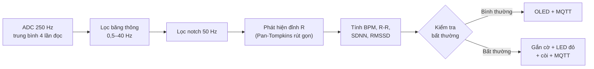
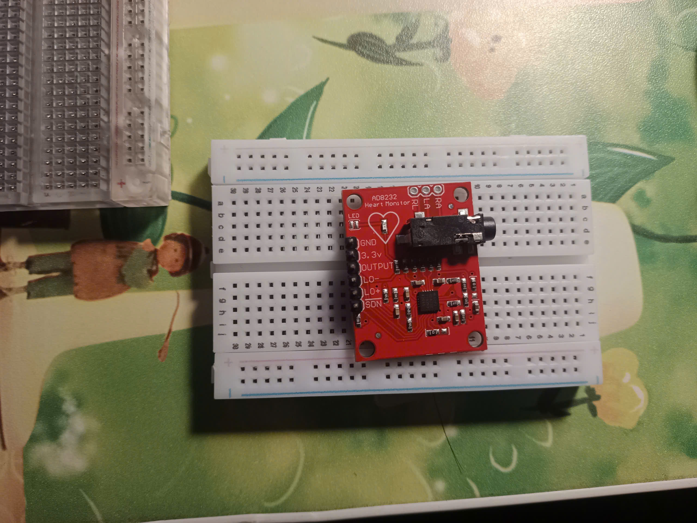

# ECG Monitor – ESP32-S3 & AD8232

**Thiết bị đo và theo dõi điện tâm đồ (ECG) thời gian thực qua IoT**

> Phần cứng: ESP32-S3 + cảm biến AD8232 · Giao thức: MQTT · Giám sát: Node-RED Dashboard · Firmware: PlatformIO/Arduino

---

## 1. Đặt bài toán

### Nhu cầu thực tế

Bệnh tim mạch là một trong những nguyên nhân gây tử vong hàng đầu, đặc biệt ở người cao tuổi. Nhiều dấu hiệu bất thường của tim (nhịp quá nhanh, quá chậm, nhịp không đều) xuất hiện thoáng qua và rất dễ bị bỏ sót nếu chỉ đi khám định kỳ.

Tuy nhiên, việc theo dõi điện tâm đồ tại nhà hiện còn nhiều khó khăn:

- Máy đo ECG trên thị trường đắt đỏ và khó mua, chủ yếu dành cho bệnh viện, phòng khám.
- Đồng hồ, vòng đeo thông minh phổ biến hơn nhưng phần lớn chỉ cho con số nhịp tim, không hiển thị dạng sóng ECG để người dùng quan sát.
- Người thân ở xa không có cách nào theo dõi tình trạng tim của người già trong nhà theo thời gian thực.

### Nguồn cảm hứng

Trong gia đình em có người cao tuổi, em muốn tạo ra sản phẩm này để đo cho người thân em. Khi tìm hiểu, em nhận thấy các thiết bị đo ECG có giá thành cao và không dễ tìm mua. Từ đó em muốn tự làm một thiết bị giá rẻ nhỏ gọn, có thể đo và hiển thị sóng ECG cho người thân, đồng thời cho phép xem từ xa bằng thiết bị thông minh.

### Mục tiêu

Xây dựng thiết bị:

1. Đo tín hiệu ECG bằng cảm biến AD8232 và ESP32-S3.
2. Hiển thị trực tiếp nhịp tim và trạng thái trên màn hình OLED gắn trên thiết bị.
3. Gửi dữ liệu qua MQTT lên broker online, hiển thị dạng sóng ECG, nhịp tim (BPM) trên Node-RED Dashboard.
4. Gắn cờ các điểm bất thường và cảnh báo bằng LED, trên thiết bị và trên Dashboard.
5. Cho phép thao tác trên kết nối bật tắt thiết bị trên Dashboard.

---

## 2. Nội dung chính

### Chức năng dự kiến

| Nhóm | Chức năng |
|---|---|
| Thu tín hiệu | Lấy mẫu ECG 250 Hz từ AD8232, phát hiện điện cực bị rơi (LO+/LO−) |
| Xử lý | Lọc nhiễu, phát hiện đỉnh R, tính BPM và các chỉ số biến thiên nhịp tim |
| Hiển thị tại chỗ | OLED: BPM, trạng thái kết nối, cảnh báo, sóng ECG thu nhỏ |
| Cảnh báo tại chỗ | LED RGB (xanh / vàng / đỏ) |
| Truyền dữ liệu | Gửi sóng ECG theo gói, BPM, cờ bất thường qua MQTT |
| Giám sát từ xa | Node-RED Dashboard: biểu đồ sóng ECG, đồng hồ BPM, nhật ký cảnh báo |
| Điều khiển từ xa | Bật/tắt cảnh báo, tắt còi, chỉnh ngưỡng nhịp tim từ Dashboard |

### Các bất thường được gắn cờ

| Cờ | Điều kiện (dự kiến, có thể chỉnh từ Dashboard) |
|---|---|
| Nhịp nhanh | BPM vượt ngưỡng trên |
| Nhịp chậm | BPM dưới ngưỡng dưới |
| Nhịp không đều | Khoảng R-R liên tiếp chênh lệch lớn bất thường |
| Điện cực bị rơi | Chân LO+ hoặc LO− của AD8232 báo mất tiếp xúc |

---

## 3. Sơ đồ khối

### Sơ đồ khối tổng thể hệ thống

### Luồng xử lý tín hiệu

### Cấu trúc topic MQTT dự kiến

| Topic | Chiều | Nội dung |
|---|---|---|
| `ecg/<device_id>/wave` | Thiết bị → Dashboard | Gói mẫu ECG (khoảng 25 mẫu mỗi gói, 10 gói/giây) |
| `ecg/<device_id>/vitals` | Thiết bị → Dashboard | BPM, R-R, SDNN, RMSSD |
| `ecg/<device_id>/alert` | Thiết bị → Dashboard | Loại bất thường, thời điểm |
| `ecg/<device_id>/status` | Thiết bị → Dashboard | Trạng thái điện cực, pin, online/offline |
| `ecg/<device_id>/cmd` | Dashboard → Thiết bị | Bật/tắt cảnh báo, tắt còi, đổi ngưỡng |

> Gửi theo gói thay vì từng mẫu để giảm số bản tin MQTT, phù hợp với giới hạn của broker online miễn phí.

---

## 4. Phần cứng

| Linh kiện | Vai trò |
|---|---|
| ESP32-S3 DevKitC-1 (N16R8, cổng UART CH343) | Vi điều khiển, WiFi |
| Module AD8232 + 3 điện cực | Thu tín hiệu ECG |
| Màn hình OLED 0.96" SSD1306 (I2C) | Hiển thị tại chỗ |
| LED RGB / WS2812 | Báo trạng thái |
| Còi buzzer | Cảnh báo âm thanh |
| Nút bấm | Tắt còi / thao tác nhanh |
| Pin Li-ion + mạch sạc | Nguồn di động, an toàn |

### Ảnh phần cứng

*Module AD8232.*

---

## 5. Kết quả sơ bộ (đã thực hiện)

Trước khi làm phần IoT, em đã xây dựng một phiên bản thử nghiệm chạy trên máy tính để kiểm chứng việc đo tín hiệu:

**Firmware (PlatformIO + Arduino, ESP32-S3)**
- Lấy mẫu 250 Hz, mỗi mẫu là trung bình 4 lần đọc ADC.
- Gửi qua Serial 115200 baud, mỗi dòng dạng `idx,adc_raw,mV,leadoff`.

**Phần mềm hiển thị trên máy tính (Python 3.11, PyQt6, pyqtgraph, pyserial)**
- Hiển thị sóng ECG kiểu "sweep" (nét chạy từ trái sang phải giống máy theo dõi bệnh viện).
- Ghi dữ liệu ra file CSV để phân tích sau.
- Tính và hiển thị BPM, R-R, SDNN, RMSSD.

*Sóng ECG thực đo được hiển thị trên phần mềm máy tính.*

Phiên bản cuối kỳ sẽ chuyển phần hiển thị này lên **OLED** và **Node-RED Dashboard** thông qua **MQTT**.

---

## 6. Sơ bộ về xử lý tín hiệu

### Lọc nhiễu (dự kiến)

Tín hiệu ECG từ AD8232 thường bị ảnh hưởng bởi:
- **Trôi đường nền** do hô hấp, chuyển động (tần số rất thấp).
- **Nhiễu điện lưới 50 Hz**.
- **Nhiễu cơ** (tần số cao).

Hướng xử lý:
- **Bộ lọc băng thông Butterworth 0,5–40 Hz**: loại trôi đường nền và nhiễu tần số cao.
- **Bộ lọc notch 50 Hz**: loại nhiễu điện lưới.

### Phát hiện nhịp tim

Dùng **thuật toán Pan-Tompkins rút gọn**, xử lý từng mẫu:
làm mượt → đạo hàm → bình phương → tích phân cửa sổ trượt → ngưỡng thích nghi.

Kết hợp thêm các bước loại bỏ đỉnh giả (thời gian trơ sau mỗi nhịp, kiểm tra biên độ, loại khoảng R-R bất hợp lý) để BPM ổn định hơn.

Các chỉ số tính được:
- **BPM**: trung bình các nhịp gần nhất.
- **R-R**: khoảng cách giữa hai đỉnh R liên tiếp.
- **SDNN, RMSSD**: chỉ số biến thiên nhịp tim, hỗ trợ phát hiện nhịp không đều.

---

## 7. Công nghệ sử dụng

- **PlatformIO + Arduino framework**: lập trình ESP32-S3.
- **MQTT** qua broker online (dự kiến HiveMQ Cloud hoặc EMQX).
- **Node-RED + Dashboard**: giám sát và điều khiển trên máy tính, điện thoại.
- **Python** (PyQt6, pyqtgraph): công cụ thử nghiệm và phân tích tín hiệu trên máy tính.

---

## 8. Kế hoạch thực hiện

| Giai đoạn | Nội dung | Trạng thái |
|---|---|---|
| 1 | Đọc tín hiệu AD8232, hiển thị sóng trên máy tính | Đã xong |
| 2 | Lọc nhiễu (băng thông + notch), ổn định phát hiện đỉnh R | Đang làm |
| 3 | Kết nối WiFi, gửi dữ liệu qua MQTT | Dự kiến |
| 4 | Node-RED Dashboard: sóng ECG, BPM, nhật ký cảnh báo, điều khiển | Dự kiến |
| 5 | OLED, LED, còi cảnh báo trên thiết bị | Dự kiến |
| 6 | Hoàn thiện vỏ, nguồn pin, thử nghiệm thực tế | Dự kiến |

---

## 9. Hướng phát triển

- Thay module AD8232 bằng **mạch analog tự thiết kế** (INA333 + OPA2333) thay cho AD8232 để giảm nhiễu và chủ động hơn về chất lượng tín hiệu.
- Gửi cảnh báo qua **Telegram** cho người thân.
- Lưu lịch sử đo để xem lại theo ngày.
- Phát hiện loạn nhịp ở mức nâng cao hơn.

---

## 10. Lưu ý an toàn

- Đây là **thiết bị phục vụ học tập và nghiên cứu**, **không phải thiết bị y tế**, không dùng để chẩn đoán hay thay thế ý kiến bác sĩ.
- Thiết bị chỉ chạy bằng **pin**. Không cắm nguồn lưới (sạc, máy tính cắm điện) khi điện cực đang gắn trên người.

---

## 11. Tài liệu tham khảo

1. Analog Devices. *AD8232: Single-Lead, Heart Rate Monitor Front End – Datasheet*, Rev. C. URL: https://www.analog.com/media/en/technical-documentation/data-sheets/ad8232.pdf
2. SparkFun Electronics. *AD8232 Heart Rate Monitor Hookup Guide*. URL: https://learn.sparkfun.com/tutorials/ad8232-heart-rate-monitor-hookup-guide
3. J. Pan and W. J. Tompkins. "A Real-Time QRS Detection Algorithm." *IEEE Transactions on Biomedical Engineering*, vol. BME-32, no. 3, pp. 230–236, 1985. URL: https://www.robots.ox.ac.uk/~gari/teaching/cdt/A3/readings/ECG/Pan+Tompkins.pdf
4. A. Rawshani. *Clinical ECG Interpretation*. Gothenburg, Sweden: ECG Waves, 2022. URL: https://ecgwaves.com/course/the-ecg-book/
